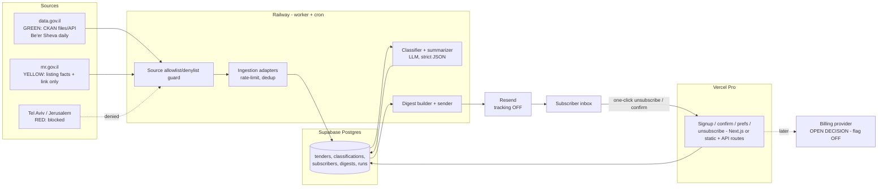

# מכרזון (Michrazon) — HLD (High-Level Design)

**גרסה:** 0.1 (טיוטה לסקירה) · **תאריך:** 24.11.2026 · **כותב:** CTO, עבור בן בלום
**סטטוס:** DESIGN ONLY. לא נוצר repo, לא נכתב קוד, לא נפתח חשבון, לא נשלחה פנייה.
**מקורות מחייבים:** `/workspace/state/income2/body.md` (דוח מחקר, 22.11.2026) ו-`/workspace/state/income2/gate.md` (בדיקת שער משפטית, 22.11.2026). כל עובדה במסמך לקוחה משם; מה שלא נמצא שם מסומן **TBD/verify**. המסמך אינו ייעוץ משפטי.
**מסמך משלים:** `LLD.md` (אותה תיקייה).

---

## 1. תקציר

מכרזון שולח בכל בוקר מייל בעברית עם מכרזים ציבוריים חדשים שרלוונטיים לספקי תוכנה, דיגיטל ו-AI בישראל (בתי תוכנה קטנים, סוכנויות, פרילנסרים). לכל מכרז יש שורת סיכום קצרה שנוצרת ב-AI, וקישור למקור הרשמי. מחיר יעד ₪99–149 לחודש. יעד: ≥₪1,500 MRR, כלומר 11 מנויים ב-₪149, 12 ב-₪129, או 16 ב-₪99.

ההחלטה המרכזית בתכנון: **המוצר בנוי סביב מה שמותר לנו לאסוף, ולא סביב מה שאפשר לאסוף.** שלושה שכבות מקורות (ירוק, צהוב, אדום) נאכפות בקוד, ולא רק בנוהל. הדיוור נקי ממעקב. הגבייה הראשונה נעולה מאחורי feature flag עד שעורך דין בדק את תנאי mr.gov.il.

## 2. מטרות ואי-מטרות

### מטרות
1. דיוור יומי אמין בעברית, מכרזים חדשים בנישה אחת בלבד.
2. סיכום קצר ומדויק עם קישור למקור. עדיף סיכום חסר מסיכום שגוי.
3. ציות מובנה: מקורות מותרים בלבד, אפס מעקב, opt-in כפול, unsubscribe בלחיצה אחת.
4. עלות שוטפת מינימלית על תשתית קיימת. אחרי ההקמה, תחזוקה של כשעה בשבוע (הערכת הדוח).
5. מצב Pilot חינמי נפרד לחלוטין מהפעלת גבייה.

### אי-מטרות
- לא "כל המכרזים לכל הענפים". הדוח מראה שמתחרה כזה (ProcureTap) לא מצליח.
- לא חיפוש, לא דשבורד, לא אנליטיקה, לא אפליקציה. אין חשבון משתמש מעבר לכתובת מייל והעדפות.
- לא העתקה, אחסון או סיכום של חוברות מכרז או PDF.
- לא איסוף מאגרגטורים מתחרים (מכרזי ישראל, BIDO ודומיהם).
- לא פנייה שיווקית אוטומטית. כל פנייה ללידים היא ידנית ובאישור בן, מחוץ למערכת.
- לא Tel Aviv-Yafo ולא Jerusalem, בשום מצב.
- לא מכירה חוזרת של AgentReady, ולא קשר לפרויקט אחר. פיתוח מתחיל רק בהתאם לכלל "פרויקט אחד בכל פעם" של בן (AgentReady Factory קודם).

## 3. היקף (Scope)

**בפנים (MVP):**
- Ingestion מ-data.gov.il (מכרזים בעיר באר שבע, עדכון יומי) ומ-mr.gov.il (עובדות ברשימה בלבד, בקצב נמוך).
- סיווג נישה וסיכום קצר ב-LLM.
- דף הרשמה, opt-in כפול, דף העדפות מינימלי (מילות מפתח אופציונליות), unsubscribe.
- דיוור יומי דרך Resend ללא מעקב.
- מצב Pilot, ובנוסף שלד גבייה כבוי ב-flag.
- ניטור בסיסי והתראות תפעול לבן.

**מחוץ ל-MVP (דחוי):** חיפה ופתח תקווה (סטטוס 🟡 "לא אומת" במקור, כבויים כברירת מחדל עד בדיקת תנאים); חברות ממשלתיות ופלטפורמות עירוניות משותפות (⚪ לא נבדק); API ללקוחות; מסלול צוותים.

## 4. ארכיטקטורה

> הערה: בחירת Next.js לדף ב-Vercel היא החלטה נוחה, לא מחייבת; ראו סעיף 11. אין שום analytics script בדפים.

### רכיבים
| רכיב | אחריות | אירוח |
|---|---|---|
| Source guard | allowlist של מקורות מותרים, denylist של RED, בדיקת host לפני כל fetch | Railway (ספרייה משותפת) |
| Ingestion adapters | אדפטר לכל מקור, מחזיר רשומות מנורמלות לפי schema קבוע | Railway cron |
| Classifier/Summarizer | קריאת LLM אחת לכל מכרז חדש, פלט JSON קשיח | Railway worker |
| Digest builder/sender | בניית מייל לכל מנוי, שליחה ב-Resend, רישום | Railway cron |
| Web/API | הרשמה, אישור, העדפות, unsubscribe, webhook סליקה (כבוי) | Vercel |
| DB | מצב, אי-חזרתיות (idempotency), suppression | Supabase |

## 5. גבולות (Boundaries)

1. **גבול מקורות:** רק הקוד בשכבת ה-adapters ניגש לרשת החיצונית, ורק דרך ה-guard.
2. **גבול נתונים:** ל-mr.gov.il נשמרים רק שדות מתוך allowlist מפורש (ראו LLD). אין שדה "גוף מסמך" בסכמה בכלל.
3. **גבול הרשאות:** ה-Web ב-Vercel לא מחזיק את מפתח ה-LLM ולא את מפתח Resend המלא לשליחה המונית; ה-worker ב-Railway לא חשוף לאינטרנט.
4. **גבול פרטיות:** בטבלאות נשמרים כתובת מייל, סטטוס הסכמה וחותמות זמן של הסכמה בלבד. אין IP, אין user-agent, אין session.

## 6. גבולות ציות למקורות

| שכבה | מקור | מותר | אסור | אכיפה |
|---|---|---|---|---|
| 🟢 ירוק | data.gov.il (רישיון פתוח, גרסה 30.8.2025 לפי ציטוט במקור; את עמוד הרישיון עצמו לא נפתח) | שימוש מסחרי, יצירות נגזרות, בתנאי ציון מקור, הצגה לא מטעה, בלי טענה לזיקה רשמית, בלי הצלבה שמזהה אדם | שימוש במאגר "דוח מכרזים" של מינהל הרכש (דוח שנתי, עודכן ב-2021, לא מתאים). הורדה בקצב גבוה. (ב-robots.txt `Disallow: /api/`; ה-API הוא הממשק הרשמי, אבל מורידים קבצים בקצב נמוך) | adapter ייעודי, rate limit, attribution footer קבוע במייל |
| 🟡 צהוב | mr.gov.il (מינהל הרכש הממשלתי) | **עובדות + קישור בלבד:** שם המכרז, מפרסם, מספר מכרז, תאריכים, URL רשמי | להעתיק, לשמור, להפיץ או לסכם חוברות/PDF. אין RSS או API רשמי; אין robots.txt (מפנה לדף הבית; meta robots = index,follow) | field allowlist בסכמה, fetch guard שדוחה PDF/attachment, בדיקת regression, ingestion מנומס: UA מזהה, backoff, תקרת בקשות |
| 🔴 אדום | Tel Aviv-Yafo (tel-aviv.gov.il), Jerusalem | כלום | כל גישה אוטומטית. תל אביב: תנאי השימוש אוסרים scraping ו"יצירת מאגר או לקט". ירושלים: חסימת בוטים (403 מ-Akamai) | allowlist + denylist + בדיקה אוטומטית שנכשלת אם הדומיינים הללו ניתנים להגדרה |
| 🔴 אגרגטורים | מכרזי ישראל וכד' | כלום | איסוף מהם | אינם ב-allowlist |
| 🟡/⚪ לא אומתו | חיפה, פתח תקווה, חברות ממשלתיות, פלטפורמות עירוניות | — | נכללים רק אחרי בדיקה בכתב | כבויים; הפעלה דורשת שינוי allowlist + אישור בן |

**סיכום AI ל-mr.gov.il:** נוצר אך ורק משדות הרשימה (כותרת, מפרסם, תאריכים). לעולם לא ממסמך. לפיכך הסיכום עבור mr.gov.il הוא בעצם סיווג רלוונטיות + שורת הקשר, ולא "היקף, תנאי סף וערבות" כפי שמוצג בדוח ברמה השיווקית. זה פשרה מכוונת; ראו סיכון R2.

## 7. צינור סיווג וסיכום AI

1. **קלט:** רשומה מנורמלת בלבד (שדות ה-allowlist של המקור).
2. **שלב אחד, קריאת LLM אחת:** מחזירה JSON קשיח: `is_relevant`, `confidence`, `category`, `summary_he` (עד ~280 תווים), `facts_used` (אילו שדות שימשו), `uncertain` (בוליאני).
3. **ולידציה:** schema validation; רשומה שנכשלה נשלחת פעם אחת ל-retry ואז מסומנת `needs_review` ולא נכללת בדיגסט.
4. **סף:** `is_relevant` ו-`confidence ≥ סף` (ערך ראשוני **TBD**, יכויל בשבוע 2 על דגימה ידנית).
5. **הגנות:** הסיכום אינו יכול להכיל מספרים או תאריכים שלא מופיעים בקלט (בדיקת post-check); תמיד מופיע קישור למקור והסתייגות קבועה "סיכום אוטומטי; יש לבדוק במסמכי המכרז הרשמיים".
6. **Model-agnostic:** שכבת provider דקה (interface), מודל ושם ספק בקונפיגורציה. אין נעילה לספק.
7. **עלות:** נמדדת בשבוע 2 לכל מכרז (הדוח: "עלות LLM לכל מכרז לא זמינה"). הערכה מבוססת-הנחות ב-LLD.

## 8. משלוח דיגסט יומי

- אצווה אחת ביום, בבוקר שעון ישראל (שעה מדויקת ב-LLD). ימי שליחה: **הנחה** — ראשון עד חמישי.
- דיגסט מכיל **רק** התראות מכרזים. אין הצעות שדרוג, קידום או פרסומת (סעיף 6 ב-gate).
- אין דיגסט ריק מיותר: ביום בלי מכרזים רלוונטיים לא נשלח מייל (**החלטה**; אפשר לשנות).
- שליחה פרטנית לכל מנוי (נדרש לקישור unsubscribe אישי).
- אידמפוטנטיות: `digest_deliveries` עם מפתח ייחודי (subscriber, digest_date) כדי שכשל באמצע לא יגרום לכפל.
- Resend: open tracking ו-click tracking כבויים; קישורים ישירים בלבד, בלי redirect.

## 9. Opt-in ו-Unsubscribe

- **Double opt-in:** הרשמה בטופס, מייל אישור עם קישור חתום ובעל תפוגה, ורק לחיצה עליו מפעילה את המנוי. עד אז לא נשלח דבר מלבד מייל האישור (שמכיל אישור בלבד, בלי תוכן שיווקי).
- **Unsubscribe בלחיצה אחת:** headers לפי RFC 8058 (`List-Unsubscribe` + `List-Unsubscribe-Post: List-Unsubscribe=One-Click`) וקישור גלוי בגוף. ה-POST מבטל מיד, ללא התחברות.
- **Suppression מיידי:** ביטול או unsubscribe מכניס את הכתובת ל-suppression בטרנזקציה אחת; ה-sender בודק אותה מחדש מיד לפני כל שליחה.
- **חוק הספאם (סעיף 30א לחוק התקשורת), רק במידה שהמקורות מכסים:** הכלל הוא הסכמה מפורשת מראש בכתב לדבר פרסומת; לפי הפרשנות במקור, דיוור שהוא השירות שהמנוי קנה אינו "דבר פרסומת", ולכן נשמר תוכן שירות בלבד. סיום מנוי נחשב הודעת סירוב. פיצוי לדוגמה עד ₪1,000 לכל הודעה, ולכן ההגנות הן קשיחות. הפרשנות אינה פסיקה; ראו שאלה פתוחה Q1.
- **Pilot:** משתתפים נכנסים רק מהרשמה יזומה שלהם בטופס. מייל הזמנה ללידים ("פנייה חד-פעמית ניטרלית" לפי gate) נעשה מחוץ למערכת, ידנית, באישור בן ודרך Email Manager, ואינו חלק מה-HLD הזה.

## 10. גבייה וזרימת עוסק פטור

- בן עוסק זעיר/פטור (osek zeir): אין גביית מע"מ. מחיר מוצג = מחיר לתשלום.
- **שני מצבים נפרדים:**
  - `MODE=pilot`: חינם, ללא פרטי תשלום, ללא קוד גבייה פעיל. מנוי פיילוט מסומן `plan='pilot'` עם `pilot_ends_at` (המלצת הדוח: שבועיים).
  - `MODE=paid`: מופעל רק ע"י feature flag `BILLING_ENABLED`. הדגל **נעול** (ב-config וגם ב-check בקוד) עד שנרשם `legal_gate_cleared_at` ע"י בן, אחרי שעה עם עורך דין על: סעיפים 1–2 בבדיקת gate ותנאי השימוש של mr.gov.il.
- **מעבר לתשלום:** משתתף פיילוט מקבל מייל שירות (לא מכירה שיווקית אוטומטית; ניסוח ומשלוח בדרך הידנית), ומצטרף לתשלום מרצונו דרך קישור checkout של ספק הסליקה.
- **מסמכי מס (קבלה לעוסק פטור):** **TBD/verify** מול רואה חשבון: הדוח לא כיסה זאת.
- **ספק הסליקה — החלטה פתוחה של בן.** הדוח: "ספק הסליקה עוד לא נבחר ולא נבדק". עיקרון: לא להוסיף שירות בתשלום אם לא חייבים, עדיפות לכלי קיים. האפשרויות (ידע כללי, **לא אומת במקורות**, יש לבדוק עמלות ודרישות לפני החלטה):

| אפשרות | יתרון | חיסרון / TBD |
|---|---|---|
| ספק שכבר יש לבן (אם קיים, TBD) | אפס הרשמה חדשה | לא ידוע מה יש |
| סולק ישראלי עם חשבונית/קבלה | קבלות מקומיות | חשבון חדש, עמלות TBD |
| Stripe או Merchant of Record בינלאומי | API טוב, מנויים מובנים | זמינות לעוסק פטור בישראל, טיפול בקבלות ומע"מ: TBD |
| גבייה ידנית בשלב ראשון (העברה/קישור תשלום) ל-11–16 מנויים | אפס אינטגרציה, אפס עמלה חדשה | עבודה ידנית, לא "אוטומטי"; מתאים רק לשלב הראשון |

המלצת CTO: המערכת מושכת מ-billing **אינטרפייס** (webhook אחד: `subscription.activated|cancelled|payment_failed`), כך שהבחירה לא חוסמת את הבנייה. ביטול בסליקה מפעיל suppression מיידי.

## 11. תשתית ועלות

עקרון: תשתית קיימת בלבד. כל סכום שלא מופיע במקורות הוא **TBD/verify**; אין להניח מחירים. "עלות שולית" = עלות נוספת בגלל מכרזון, בהנחה שהחשבון כבר משולם.

| רכיב | תפקיד | מצב לפי מקורות/זיכרון | עלות שולית צפויה | הערות |
|---|---|---|---|---|
| Vercel | Web/API (הרשמה, אישור, unsubscribe) | בן מחזיק תוכנית Pro (29.10.2026) | ₪0 (הנחה) | אין analytics; לא להפעיל Vercel Analytics/Speed Insights |
| Supabase | Postgres + RLS | קיים פרויקט; שכבה: TBD | ₪0 (הנחה); גבולות Free TBD | מומלץ פרויקט/סכמה נפרדים לפרויקט; החלטה בקיק-אוף |
| Resend | שליחת מיילים | קיים; תוכנית ומכסות: TBD | ₪0 (הנחה) עד מכסת התוכנית; TBD | tracking כבוי; דומיין שולח ייעודי: TBD |
| Railway | worker + cron | "כבר משולם" לפי הדוח | ₪0 (הנחה) | שימוש קל: דקות ספורות ביום |
| LLM API | סיווג וסיכום | ספק לא נקבע | **TBD** — לא נמדד; נוסחה והנחות ב-LLD §10 | תקרת הוצאה יומית בקוד |
| סליקה | גבייה | לא נבחר | **TBD** — עמלה לפי ספק | פעיל רק אחרי gate משפטי |
| דומיין | כתובת שולח/אתר | TBD | TBD | אפשר תת-דומיין של דומיין קיים |
| עורך דין | שעה אחת לפני גבייה | חד-פעמי | **TBD** (עלות לא במקורות) | תנאי לגבייה |
| Devin/CTO/QA | בנייה | "Devin כבר במנוי" לפי הדוח | ₪0 הקמה (לפי הדוח) | |
| מע"מ | — | עוסק פטור | ₪0 | |

**סיכום:** עלות הקמה כמעט ₪0 (הדוח). עלות שוטפת = LLM + עמלת סליקה, שתיהן TBD עד מדידה. ההכנסה ביעד ≥₪1,500; לכן שולי רווח חיוביים צפויים אלא אם עלות ה-LLM חריגה; בדיקה בשבוע 2.

## 12. ניטור ותפעול

- **טבלת `pipeline_runs`:** כל ריצה (ingest/classify/digest) רושמת התחלה, סיום, ספירות ושגיאות.
- **התראות לבן** (מייל פנימי, לא ל-subscribers): ריצת ingest נכשלה; 0 מכרזים חדשים 3 ימים ברציפות ממקור פעיל (אפשרי שינוי מבנה); שיעור כשל סיווג מעל סף; דיגסט לא נשלח עד תום חלון; bounce או complaint מ-Resend; הוצאת LLM מעל תקרה.
- **Failure handling:**
  - מקור נופל: ממשיכים עם השאר; הדיגסט יוצא עם מה שיש; אין חזרה אוטומטית אגרסיבית (backoff, תקרת ניסיונות).
  - LLM נופל: retry עם backoff; אחרי כישלון, מכרז לא נכנס לדיגסט של היום (לא מוציאים סיכום ריק) ונכנס למחר אם עדיין חדש.
  - Resend נופל: ניסיון חוזר אידמפוטנטי; לא שולחים פעמיים.
  - שינוי מבנה ב-mr.gov.il: ה-parser נכשל בצורה "סגורה" (fail closed) ולא ממלא שדות ניחושיים.
- **Kill switch:** דגל לכל מקור (`source.enabled`) מאפשר השבתה מיידית, בלי deploy.
- **Bounce/complaint:** hard bounce וה-complaint מכניסים ל-suppression. זה נעשה מתוך webhooks של Resend שאינם משמשים ל-tracking משתמשים (אירוע משלוח בלבד, ללא open/click) — ראו LLD.

## 13. בחירות טכנולוגיות ופשרות

| החלטה | בחירה | סיבה | פשרה |
|---|---|---|---|
| DB | Supabase Postgres | קיים, RLS, פשוט | תלות בשכבה; גבולות TBD |
| Worker | Node/TypeScript (או Python) ב-Railway cron | cron פשוט; בן עובד עם TS | לשיקול בקיק-אוף; לא נעול |
| Web | Vercel, דפים סטטיים + API routes מינימליים | Pro כבר קיים | שומרים אפס client scripts מעבר לטופס |
| LLM | provider-agnostic, JSON קשיח | להימנע מנעילה | עבודת abstraction קטנה |
| דיוור | Resend, שליחה פרטנית | קיים; תומך ב-headers מותאמים | מגבלת קצב לפי תוכנית TBD |
| Unsubscribe | טוקן HMAC חתום, stateless | בלי session | רוטציית מפתח דורשת תכנון |
| Scheduling | Railway cron + בדיקת שעה לפי Asia/Jerusalem | cron ב-UTC אינו עוקב DST | לוגיקה קטנה בקוד |
| קישורים במייל | ישירים, בלי redirect | אפס מעקב קליקים | אין מדידה של מעורבות; מדד היחיד הוא retention (ביטולים) |
| mr.gov.il | רק רשימה, אין הורדת PDF | שער זכויות יוצרים | סיכום פחות עשיר |

## 14. סיכונים

| # | סיכון | חומרה | מענה |
|---|---|---|---|
| R1 | תנאי השימוש של mr.gov.il לא נבדקו משפטית; ייתכן איסור על איסוף אוטומטי | גבוהה | נעילת גבייה; ingestion מנומס; kill switch; שעה עם עו"ד; אופציה: בקשת אישור בכתב (באישור בן בלבד) |
| R2 | ערך הסיכום ל-mr.gov.il נמוך כשהוא מוגבל לרשימה | בינונית | הצגה כ"התראה + סיווג"; להוכיח ערך על מכרזים עם עובדות עשירות; תנאי עצירה: <20 מכרזים רלוונטיים בחודש (הדוח) |
| R3 | סיכום AI שגוי עולה ללקוח מכרז | גבוהה | קישור תמידי למקור, הסתייגות, post-check, אפס מספרים ללא מקור בקלט |
| R4 | חוק הספאם: פיצוי עד ₪1,000 להודעה | גבוהה | double opt-in, שירות בלבד, suppression מיידי, אין פניה אוטומטית |
| R5 | תחרות (≥5 שירותים בתשלום; RFP Cafe חינמי) | בינונית | נישה צרה ואיכות סיכום |
| R6 | מקור data.gov.il (באר שבע) הוא עיר אחת; כיסוי דל | גבוהה | להעריך כמות רלוונטית בשבוע 1; לבחון מאגרים נוספים ב-data.gov.il (TBD) |
| R7 | שינוי מבנה/חסימה ב-mr.gov.il | בינונית | fail closed, ניטור, kill switch |
| R8 | עלות LLM לא ידועה | בינונית | מדידה בשבוע 2, תקרת הוצאה |
| R9 | הפרת "פרויקט אחד בכל פעם" | ניהולית | קיק-אוף ידני של בן אחרי AgentReady Factory |
| R10 | פגיעה במוניטין אם נראה כ"רשמי" | בינונית | אין לוגו/שם רשמי; footer: "שירות פרטי, אינו קשור לגוף ממשלתי" |

## 15. Rollout: Pilot → Paid

1. **שבוע 1 (שער):** בדיקת תנאים (בוצעה חלקית ב-gate), ספירת מכרזים רלוונטיים בחודש. תנאי עצירה: <20.
2. **שבוע 2 (בנייה):** MVP, מדידת עלות LLM, כיול סף. (תכנון הדוח: 30.11–6.12; קיק-אוף בפועל תלוי בבן.)
3. **שבוע 3 (Pilot חינמי, `MODE=pilot`):** שבועיים; הרשמה יזומה; ללא גבייה.
4. **שבוע 4+ (המרה):** רק אם `legal_gate_cleared_at` נקבע ובן בחר ספק סליקה והפעיל `BILLING_ENABLED`. יעד יום 30 לפי הדוח: 3–5 משלמים. עצירה: <10 משתתפי פיילוט ו-<3 משלמים.
5. **יעד:** 11–16 מנויים, ≥₪1,500 MRR, בטווח 3–6 חודשים (הערכת הדוח).

## 16. שאלות פתוחות (Open Questions)

אלה בבעלות בן, אלא אם צוין:
1. **Q1 — סקירת עו"ד (בן):** שעה על סעיפים 1–2 ב-gate ועל תנאי mr.gov.il, כולל פרשנות "דבר פרסומת" לדיוור שירות.
2. **Q2 — מחיר סופי (בן):** ₪99 / ₪129 / ₪149 (נקודות המחיר בדוח).
3. **Q3 — קיק-אוף פיתוח ידני (בן):** מתי, ובכפוף לסיום AgentReady Factory.
4. **Q4 — ספק סליקה (בן):** סעיף 10.
5. **Q5 — קבלות לעוסק פטור (TBD/verify):** מול רו"ח.
6. **Q6 — טקסט הרישיון המלא של data.gov.il:** לא נפתח; לוודא את נוסח attribution המדויק.
7. **Q7 — מזהי dataset ו-URL מדויקים** של "מכרזים בעיר באר שבע" ב-CKAN: לא נרשמו במקורות; לאתר בקיק-אוף.
8. **Q8 — מבנה עמוד הרשימה ב-mr.gov.il** (22,327 תוצאות): איך מבצעים סינון/עימוד; האם הדף מסתמך על JS; TBD.
9. **Q9 — מאגרי data.gov.il נוספים** מעבר לבאר שבע: TBD.
10. **Q10 — חיפה, פתח תקווה, חברות ממשלתיות:** האם להכליל (דורש בדיקה בכתב).
11. **Q11 — שכבות Supabase ו-Resend בפועל** ומכסותיהן; ספק LLM ותקציב יומי.
12. **Q12 — דומיין שולח** ל-Resend (SPF/DKIM/DMARC).
13. **Q13 — ימי שליחה ושעה:** ראשון–חמישי 07:30? (הנחה).
14. **Q14 — דיגסט ריק:** לא לשלוח (ברירת מחדל מוצעת).
15. **Q15 — תיקון 13 לחוק הגנת הפרטיות:** לא נבדק במקורות; רלוונטי לאחסון כתובות מייל.

## 17. הנחות (Assumptions)

- A1: Vercel Pro, Railway ו-Resend כבר משולמים ופנויים לפרויקט (לפי הדוח והזיכרון) ולכן עלות שולית ₪0; שכבת Supabase ו-Resend בפועל לא ידועה.
- A2: המשתמש היעד קורא עברית ומעוניין בדיגסט בבוקר.
- A3: דיגסט נשלח ראשון–חמישי; סופי שבוע ללא משלוח.
- A4: עד ~30 מכרזים חדשים ביום בכל המקורות המותרים, מתוכם 3–8 רלוונטיים (הנחת עבודה לתכנון בלבד, לא נתון במקורות).
- A5: עד ~50 מנויים בשנה הראשונה (לתכנון קיבולת בלבד).
- A6: ה-API/קבצי data.gov.il נגישים בהורדה בקצב נמוך, כפי שנצפה ב-22.11.2026.
- A7: אף מנוי לא מקבל מידע מעבר למה שהזין; אין הצלבה שמזהה אדם.
- A8: ללא בן אין שליחה, גבייה או פנייה; כל פעולה חיצונית באישורו.

## 18. Compliance checklist

סימון ✅ = התכנון מקיים; כל סעיף מצביע על מנגנון ובדיקה ב-LLD.

| # | דרישה | סטטוס | מנגנון |
|---|---|---|---|
| 1 | **Tel Aviv-Yafo ו-Jerusalem מוחרגות** | ✅ | denylist (`tel-aviv.gov.il`, `jerusalem.muni.il` ותת-דומיינים) + allowlist סגורה; בדיקה AC-01 נכשלת אם הדומיינים מופיעים בקונפיג או ב-fetch |
| 2 | **mr.gov.il: עובדות + קישור בלבד, אפס PDF/חוברות** | ✅ | field allowlist; אין עמודת מסמך בסכמה; fetch guard דוחה PDF/attachment/Content-Type לא-HTML; AI רק מעובדות הרשימה; AC-02..AC-04 |
| 3 | **אפס מעקב: open/click/session** | ✅ | Resend tracking כבוי (ובדיקה בקוד/API), קישורים ישירים, אין pixel, אין analytics, אין cookies/session; AC-10..AC-12 |
| 4 | **טבלת עלות מלאה בגבולות תשתית קיימת/מינימלית** | ✅ | סעיף 11; פריטים ללא נתון מסומנים TBD ולא נוחשו |
| 5 | **קריטריוני קבלה ניתנים לבדיקה** | ✅ | LLD §16, AC-01..AC-30 ממוספרים |
| 6 | data.gov.il ירוק: ציון מקור, לא מטעה, בלי טענת זיקה; לא דוח 2021 | ✅ | footer attribution; denylist ל-dataset 2021; AC-05, AC-06 |
| 7 | double opt-in, one-click unsubscribe (RFC 8058), דיגסט התראות בלבד, suppression מיידי | ✅ | סעיף 9; LLD §12; AC-13..AC-20 |
| 8 | עוסק פטור, Pilot נפרד מגבייה, גבייה נעולה עד בדיקת עו"ד | ✅ | `MODE`, `BILLING_ENABLED`, `legal_gate_cleared_at`; AC-21..AC-23 |
| 9 | החלטות פתוחות של בן לא נבחרו בשמו | ✅ | סעיף 16: עו"ד, מחיר, קיק-אוף, ספק סליקה |
